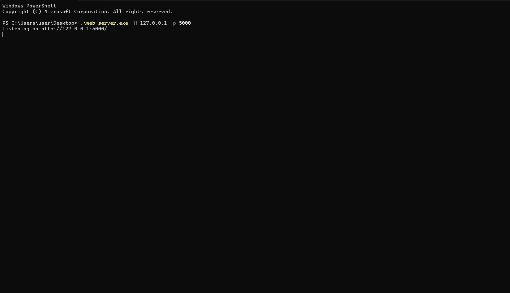

# web-server

A minimal, multi-threaded HTTP/1.1 static file server written in ~100 lines of Rust. 

## Screenshot


## Features
- **Multi-threaded:** Uses a worker thread pool to handle concurrent requests.
- **Static File Serving:** Serves HTML, CSS, JS, and TXT files with correct MIME types, routing `/` to `index.html`.
- **Configurable:** Easily change the host and port via CLI arguments.

## Quickstart

Ensure you have [Rust](https://rustup.rs/) installed, then clone and run:

```bash
# Run on default host and port (127.0.0.1:5000)
cargo run

# Or specify custom host and port
cargo run -- --host 0.0.0.0 --port 8080
```

To test it, create an `index.html` file in the root directory and visit `http://127.0.0.1:5000` in your browser.

## CLI Options

```text
Options:
  -H, --host <HOST>  [default: 127.0.0.1]
  -p, --port <PORT>  [default: 5000]
  -h, --help         Print help
  -V, --version      Print version
```

## Dependencies

This project keeps it lightweight, relying only on:

* `clap` for CLI argument parsing
* `threadpool` for concurrent workers
* `httparse` for safe HTTP header parsing
